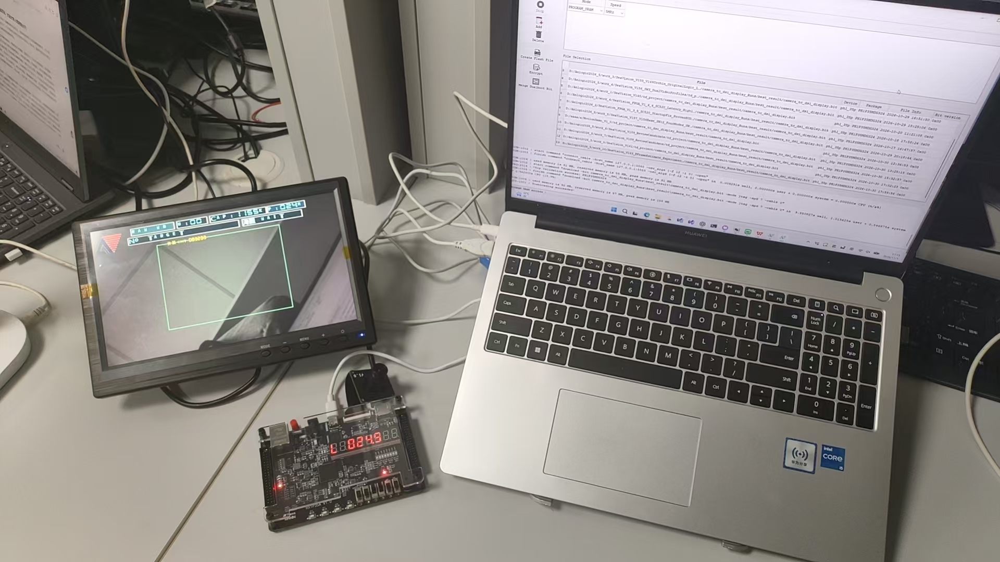
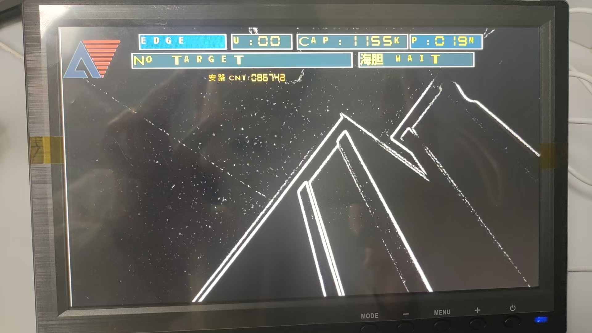
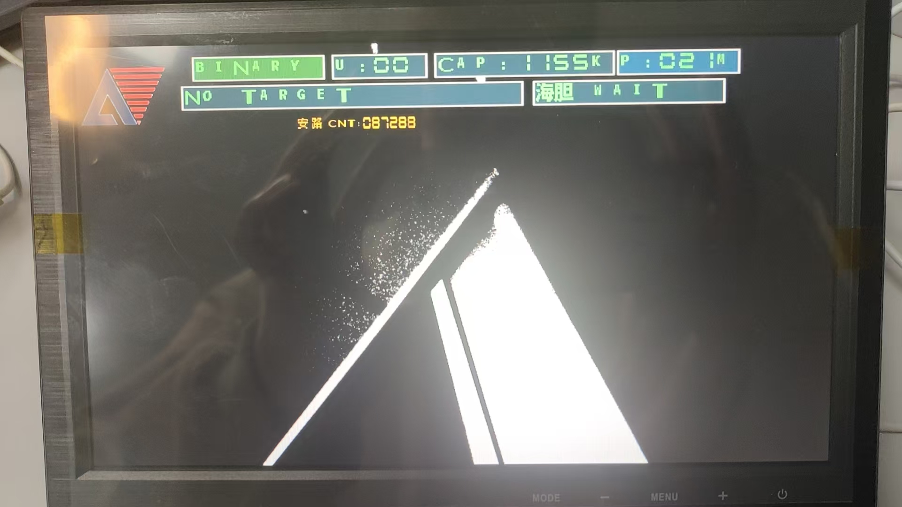
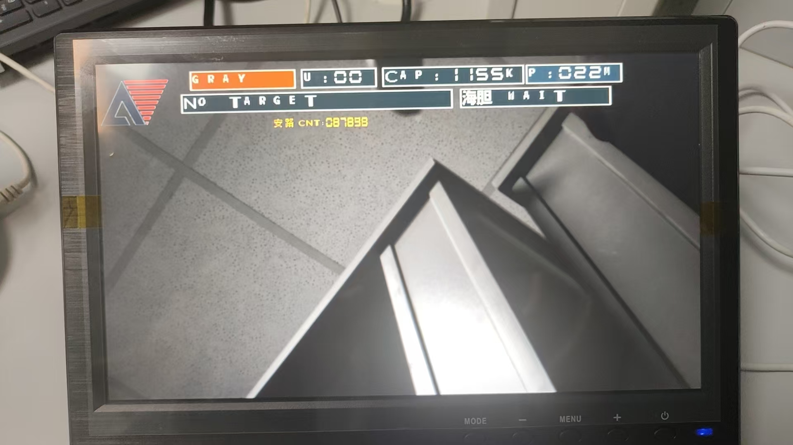
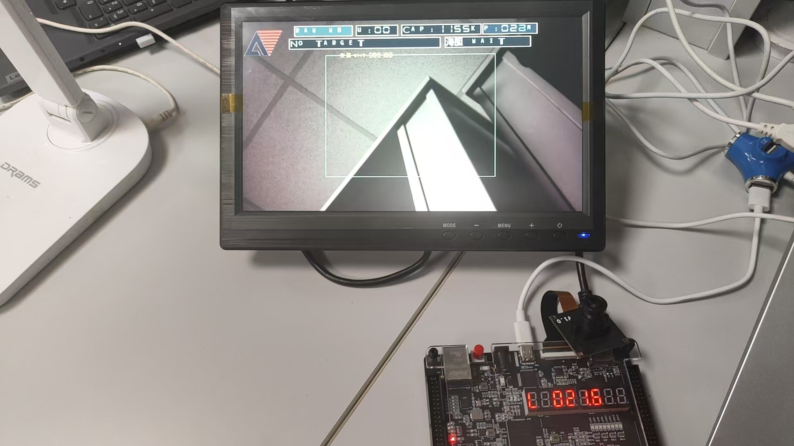

# 海牧慧眼 · SeaVision FPGA

**基于安路 PH1P35 的实时水下视觉检测系统｜V1.6.4 源码整理版**

> 目标：使用 FPGA 实时处理 MIPI 摄像头视频，输出 HDMI 画面并实现轻量级目标检测、模式切换及可视化状态反馈。

## 项目概览

| 项目 | 实现方案 |
|---|---|
| 主控 | HX1P35A / PH1P35MDG324 FPGA |
| 视频链路 | SC520CS → MIPI/ISP → DDR 缓存 → HDMI |
| 显示模式 | RAW WB、EDGE、GRAY、BINARY |
| 海胆候选 | 亮度/色度约束 + RLE 连通区域 + 四维线性 SVM 辅助判别 |
| 其他目标 | 粉色物块颜色区域定位 |
| 信息叠加 | OSD、动态检测框、坐标、ROI 状态、SVM 得分 |
| 实时监测 | CAP 周期、视频数据通路时延及板载数码管 |

## 功能展示（V1.6.3 实拍）

| 边缘检测 EDGE | 二值化 BINARY | 灰度 GRAY |
|:---:|:---:|:---:|
|  |  |  |

## 模块代码

| 模块 | 关键文件 |
|---|---|
| 海胆检测与四维 SVM | [`seavision_urchin_detector_lite.v`](user_source/hdl_source/seavision_urchin_detector_lite.v) |
| 视频样本与采集接口 | [`seavision_urchin_stream_tap.v`](user_source/hdl_source/seavision_urchin_stream_tap.v) |
| 粉色目标检测 | [`seavision_pink_regions.v`](user_source/hdl_source/seavision_pink_regions.v) |
| 图像增强 | [`seavision_adaptive_tone.v`](user_source/hdl_source/seavision_adaptive_tone.v) |
| 四种 HDMI 画面 | [`seavision_hdmi_display_modes.v`](user_source/hdl_source/seavision_hdmi_display_modes.v) |
| 文字与目标状态叠加 | [`seavision_mode_osd.v`](user_source/hdl_source/seavision_mode_osd.v) |
| 帧关联计时 | [`seavision_frame_latency.v`](user_source/hdl_source/seavision_frame_latency.v) |
| 数码管毫秒显示 | [`seavision_sevenseg_latency.v`](user_source/hdl_source/seavision_sevenseg_latency.v) |

完整模块索引见 [docs/MODULE_INDEX.md](docs/MODULE_INDEX.md)，算法链路见 [docs/DETECTION_PIPELINE.md](docs/DETECTION_PIPELINE.md)。

## V1.6.4 说明与验证边界

V1.6.4 只更新无有效海胆目标时的 SVM/P 显示归零逻辑；原有四维 SVM 参数、筛选链路和目标检测阈值未更换。

目前完成 OSD 模块级 RTL 检查；完整工程展开仍存在黑盒错误，**尚未完成 V1.6.4 的整工程综合、布局布线和实板验证**。页面展示的实机照片来自 V1.6.3。

本公开仓库专注 SeaVision 可公开的功能模块，**不包含厂商加密 IP、完整板级配套源文件与综合数据库**，因此不能直接在独立环境下一键编译。请参阅 [构建与验证说明](docs/BUILD_AND_VALIDATION.md) 及 [依赖清单](docs/VENDOR_DEPENDENCIES.md)。

## 版权说明

第三方代码、芯片 IP、官方参考工程由原权利人拥有。公开内容的使用应遵循原始许可和合作约定；详见 [NOTICE.md](NOTICE.md)。
